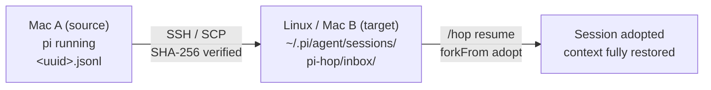

<a id="readme-top"></a>

<div align="center">

# pi-hop

**"Hop" your current Pi session to another machine and keep going — with zero context loss.**

A minimal Pi extension built on plain system SSH: Mac → Linux, Mac → Mac, just type an address.
The target machine needs **no service, no port** — after receiving, run `/hop resume` to continue the conversation seamlessly.

[](https://www.npmjs.com/package/pi-hop)
[](https://www.npmjs.com/package/pi-hop)
[](./LICENSE)
[](https://github.com/robotbird/pi-hop/stargazers)
[](https://github.com/robotbird/pi-hop/commits)

[Quick Start](#-quick-start) · [Commands](#-commands) · [How It Works](#%EF%B8%8F-how-it-works) · [Report Bug](https://github.com/robotbird/pi-hop/issues)

**English** | [简体中文](README.zh-CN.md)

</div>

<details open>
<summary><b>📖 Table of Contents</b></summary>

- [🎯 Why This Exists](#-why-this-exists)
- [✨ Features](#-features)
- [📦 Installation](#-installation)
- [🚀 Quick Start](#-quick-start)
- [📖 Usage](#-usage)
  - [Commands](#-commands)
  - [Typical Scenarios](#typical-scenarios)
  - [Auto-running Unfinished Tasks: `--run`](#auto-running-unfinished-tasks---run)
- [🏗️ How It Works](#%EF%B8%8F-how-it-works)
- [🔒 Design Details](#-design-details)
- [📁 Project Structure](#-project-structure)
- [🧪 Testing](#-testing)
- [🗺️ Roadmap](#%EF%B8%8F-roadmap)
- [🤝 Contributing](#-contributing)
- [📄 License](#-license)

</details>

## 🎯 Why This Exists

You're deep in a task on your Mac — then you need to move: to a beefy Linux server, to a new laptop, or the machine next to you. Copy-pasting the conversation doesn't work: tool calls, branches and compaction summaries don't survive it, and the agent loses the thread.

pi-hop treats the session file as the single source of truth. One command pushes it over SSH — the same SSH you already trust — and the target machine adopts it byte-for-byte, so the conversation continues exactly where it left off. No sync services, no accounts, no ports to open.

<p align="right">(<a href="#readme-top">back to top ⬆️</a>)</p>

## ✨ Features

- **Byte-perfect migration** — the session JSONL is copied as-is: messages, tool calls, branch tree, compaction summaries and `/name` labels all survive the hop
- **Zero server-side setup** — uses the system OpenSSH (`ssh`/`scp`); the receiver opens no service and no port
- **SHA-256 end-to-end verification** — local hash is computed before transfer and compared with a hash read back on the remote side, so a corrupted transfer can never be mistaken for a good file
- **Snapshot semantics** — the session is only copied once the agent is idle and fully flushed to disk; the source session is read-only and never modified
- **Non-destructive adoption** — every resume creates a brand-new session file on the target machine; the inbox original is archived, nothing is overwritten or deleted
- **One-time SSH setup** — first connection guides you through host-fingerprint verification and `ssh-copy-id`; after that, just `/hop <ip>`

<p align="right">(<a href="#readme-top">back to top ⬆️</a>)</p>

## 📦 Installation

```bash
# Install from npm (recommended)
pi install npm:pi-hop

# Install from a local source directory (development)
pi install ./pi-hop

# Try it once without writing to your config
pi -e ./pi-hop/src/index.ts
```

Install once on **both** machines. The receiver does **not** need any service or open port — the sender pushes the session file over system `ssh`/`scp` into a fixed inbox at `~/.pi/agent/sessions/pi-hop/inbox/`.

### SSH Prerequisites (one-time)

Automatic transfer runs in SSH `BatchMode`, so password-less login is required. The first time you send to a machine, pi-hop will guide you interactively if needed:

1. **Host fingerprint not verified yet** → pi-hop suspends the TUI and runs `ssh user@host exit` so you can confirm the fingerprint yourself (pi-hop never disables `StrictHostKeyChecking`)
2. **Public key not authorized yet** → pi-hop runs `ssh-copy-id user@host`; enter your password once
3. After that, the same machine only ever needs `/hop <ip>`

> For machines with a non-standard SSH port, give them a `Host` alias in `~/.ssh/config` and then `/hop <alias>`.

<p align="right">(<a href="#readme-top">back to top ⬆️</a>)</p>

## 🚀 Quick Start

```bash
# 1. On the target machine: install pi-hop once, then open pi in your project directory
pi install npm:pi-hop
cd ~/my-project && pi

# 2. On the source machine: hop the current session over
/hop ubuntu@192.168.1.105

# 3. On the target machine: adopt the received session and keep chatting
/hop resume
```

That's it — the full conversation history (messages, tool calls, branches, compaction) is restored and you can continue asking questions immediately.



<p align="right">(<a href="#readme-top">back to top ⬆️</a>)</p>

## 📖 Usage

### Commands

| Command | What it does |
| --- | --- |
| `/hop <user@host>` | Send the current session to the target machine (e.g. `/hop ubuntu@192.168.1.105`) |
| `/hop <user@host> --run` | After sending, have pi on the target machine **continue an unfinished task automatically** (see below) |
| `/hop <user@host> --run <prompt> --dir <remote-dir>` | Customize the continuation prompt and the remote working directory |
| `/hop resume` | Pick a received session from the inbox, adopt it and switch to it |
| `/hop list` | Browse the inbox, archived sessions and recent targets |
| `/hop` | Interactive menu (send / resume / list) |
| `/hop-auto adopt <file>` | Internal command: headlessly invoked by `--run` on the target machine; adopts the file and prints the new session path |

Command arguments support autocompletion (`resume`, `list`, recent targets).

### Typical Scenarios

| Scenario | What you do |
| --- | --- |
| **Mac → Linux**: move a half-finished task to your server | Source: `/hop user@192.168.1.105`; server: `cd <project> && pi`, then `/hop resume` |
| **Mac → Mac**: switch to a new laptop and take the session with you | Source: `/hop user@<new-machine-ip>`; new machine: `/hop resume` |
| **Seamless continuation** | The full JSONL history (messages, tool calls, branches, compaction, labels) is migrated — keep chatting without losing context |

### Auto-running Unfinished Tasks: `--run`

Sending is only step one — `--run` lets the target machine finish the job by itself:

```bash
/hop ubuntu@192.168.1.105 --run
# or specify the remote directory and a custom continuation prompt:
/hop ubuntu@192.168.1.105 --run --dir /srv/myapp "Finish the test that's failing in CI"
```

The send-and-verify flow is identical to normal mode. Afterwards, over the same SSH channel, the extension runs on the target machine:

```
1. mkdir -p <remote-dir>            # default: ~/pi-hop-workspace/<project>, override with --dir
2. pi --print --no-session \
     "/hop-auto adopt <inbox-file>" # headless adopt on the remote side; stdout returns the new session path
3. pi --print --session <new-session> \
     "<continuation prompt>"        # headless continuation run; may use tools and take minutes
   └─ default prompt: review the history above → find unfinished work → autonomously execute it to completion → summarize
```

When it finishes, the full stdout/stderr is written to `~/.pi/agent/sessions/pi-hop/last-remote-run.log` on your machine; the notification shows the exit code and the tail of the output. The continuation run itself lives in the target machine's session file — SSH in and `pi --resume` anytime to take over manually. Pressing `Esc` while monitoring also kills the remote pi (SSH channel drops → SIGHUP).

**Requirements and caveats of `--run`:**

- The target machine has `pi install ./pi-hop` **and** is already logged in to a model (has run `pi` interactively at least once)
- Project files must already exist on the target (`--dir` points at an existing checkout); pi-hop does **not** migrate code
- Remote execution consumes the model quota configured on the *target* machine
- Closing the lid or losing network kills the SSH channel and thus the remote task — for long jobs, use a real server

<p align="right">(<a href="#readme-top">back to top ⬆️</a>)</p>

## 🏗️ How It Works

### Sender flow

```
/hop user@host
  1. Confirm the agent is idle (isIdle) — copy only after the session is flushed to disk
  2. Read the current session file (SessionManager.getSessionFile()), compute SHA-256
  3. Probe connectivity/auth over ssh (BatchMode; fail fast and classify the error)
  4. ssh 'mkdir -p .pi/agent/sessions/pi-hop/inbox'
  5. scp the session file → remote inbox (filename kept as-is)
  6. Read back the remote hash (sha256sum / shasum -a 256) and compare; mismatch = error
  7. On success: record the target in targets.json; append a "pi-hop.send" marker to this session
```

A progress dialog shows each stage in real time; `Esc` aborts (killing the ssh/scp child processes). The source session is read-only — nothing is deleted.

### Receiver flow

```
/hop resume
  1. List inbox/*.jsonl (parsing session name / first user message / entry count / source dir / time / size)
  2. Pick one and confirm → SessionManager.forkFrom(inbox file, current directory)
     — this is Pi's official "adopt a session across projects" mechanism:
       · every entry except the header is copied byte-for-byte (messages, tool calls, branch tree, compaction…)
       · new header: new session ID + the local working directory
  3. ctx.switchSession() switches to the adopted session → context fully restored, keep asking
  4. The inbox original is moved to inbox/imported/ (archived, never overwritten, recoverable)
```

**Why it's seamless:** Pi rebuilds context entirely from the session file. Once the JSONL is migrated as-is, the model sees the same conversation, branch positions and compaction summaries as on the source machine. The only change is the header's `cwd`, remapped to the target machine's current directory — so tool operations act directly on the project that lives there.

<p align="right">(<a href="#readme-top">back to top ⬆️</a>)</p>

## 🔒 Design Details

1. **JSONL preserved as-is** — no Markdown conversion, no summary regeneration. Tool calls, session tree, compaction and `/name` labels all migrate byte-for-byte; adoption only rewrites the header (new ID + local cwd).
2. **SSH transport** — system OpenSSH, no self-built server. The first connection handles fingerprint verification and key authorization; afterwards the same machine only needs the IP. Connection/auth failures are classified with actionable guidance.
3. **Snapshot semantics + SHA-256** — the file is copied only when the agent is idle and flushed; the local hash is computed before scp and compared against the read-back remote hash, so transport corruption can never pass as a valid file. Messages appended after sending are not part of the snapshot (inherent semantics of copy-style migration).
4. **The receiver never overwrites existing sessions** — every adoption creates a new session file (new ID) in the standard session directory of the current project; the inbox original is archived, not deleted.
5. **The sender never deletes history** — pure copy migration; after resuming, both ends evolve independently, with no bidirectional merging.
6. **Clear boundaries** — what migrates is the **full session history**, not a **full execution environment**. The target still needs its own model auth, extensions and project files; system prompts, workspace rules and external files the source session depended on may differ across machines. "Full context" means no historical data is missing.

<p align="right">(<a href="#readme-top">back to top ⬆️</a>)</p>

## 📁 Project Structure

```
pi-hop/
├── package.json          # pi package manifest (pi.extensions → src/index.ts)
├── tsconfig.json         # type checking (npm run typecheck)
├── README.md
├── smoke.ts              # smoke tests (parse/adopt/verify — node smoke.ts)
├── transfer-e2e.ts       # transfer end-to-end tests (with fake ssh/scp shims)
├── corrupt-e2e.ts        # corruption-detection tests
└── src/
    ├── index.ts          # /hop command entry, UI flow, progress dialog, transfer markers
    ├── transfer.ts       # SSH/SCP transfer, error classification, sha256, interactive first connect
    └── session.ts        # inbox parsing, forkFrom adoption, archiving, target memory
```

Runtime data (same path on both ends, so the sender can address it):

```
~/.pi/agent/sessions/pi-hop/
├── inbox/            # received sessions (*.jsonl)
│   └── imported/     # archive of adopted sessions
└── targets.json      # recent send targets (max 10)
```

<p align="right">(<a href="#readme-top">back to top ⬆️</a>)</p>

## 🧪 Testing

```bash
npm install          # install typescript/@types (for type checking)
npm run typecheck    # tsc --noEmit
node smoke.ts        # 21 checks: target parsing, sha256, inbox parsing, forkFrom adoption, archiving
```

The transfer pipeline can be verified end-to-end with fake ssh/scp shims (simulating remote mkdir/scp/sha256sum), covering: normal transfer, byte-for-byte content equality, and checksum failure when the payload is tampered with in transit. Real two-machine acceptance follows the "typical scenarios" manually.

<p align="right">(<a href="#readme-top">back to top ⬆️</a>)</p>

## 🗺️ Roadmap

- [ ] Non-standard SSH ports directly on the command line (currently: `~/.ssh/config` alias), IPv6 addresses, batch sending of multiple sessions
- [ ] Optional enhancements: target aliases, an explicit `/hop send` subcommand, post-send hint to open the remote session directly with `pi --session`
- [ ] Explicitly out of scope: file/config/background-task sync, bidirectional merge, device auto-discovery — to keep the MVP lean

**Positioning: pi-hop is a lightweight, SSH-based Pi session migration extension — not a remote development framework.**

<p align="right">(<a href="#readme-top">back to top ⬆️</a>)</p>

## 🤝 Contributing

Issues and pull requests are welcome!

- 🐛 [Report a bug](https://github.com/robotbird/pi-hop/issues/new?labels=bug)
- 💡 [Request a feature](https://github.com/robotbird/pi-hop/issues/new?labels=enhancement)

Before submitting, please run `npm run typecheck && node smoke.ts` locally.

<p align="right">(<a href="#readme-top">back to top ⬆️</a>)</p>

## 📄 License

Distributed under the [MIT License](./LICENSE).

<p align="right">(<a href="#readme-top">back to top ⬆️</a>)</p>
