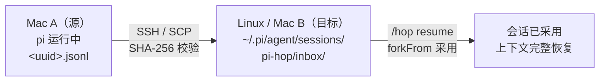

<a id="readme-top"></a>

<div align="center">

# pi-hop

**把当前 Pi 会话"跳"到另一台机器上继续——上下文零丢失。**

基于系统 SSH 的极简 Pi Extension：Mac → Linux、Mac → Mac，只需填一个地址；
目标机器**无需部署任何服务、不开任何端口**，收到后 `/hop resume` 即可无损续聊。

[](https://www.npmjs.com/package/pi-hop)
[](https://www.npmjs.com/package/pi-hop)
[](./LICENSE)
[](https://github.com/robotbird/pi-hop/stargazers)
[](https://github.com/robotbird/pi-hop/commits)

[快速开始](#-快速开始) · [命令](#-命令) · [工作原理](#%EF%B8%8F-工作原理) · [报告问题](https://github.com/robotbird/pi-hop/issues)

[English](README.md) | **简体中文**

</div>

<details open>
<summary><b>📖 目录</b></summary>

- [🎯 为什么需要它](#-为什么需要它)
- [✨ 特性](#-特性)
- [📦 安装](#-安装)
- [🚀 快速开始](#-快速开始)
- [📖 使用](#-使用)
  - [命令](#-命令)
  - [典型场景](#典型场景)
  - [自动执行未完成任务：`--run`](#自动执行未完成任务---run)
- [🏗️ 工作原理](#%EF%B8%8F-工作原理)
- [🔒 设计细节](#-设计细节)
- [📁 目录结构](#-目录结构)
- [🧪 测试](#-测试)
- [🗺️ 路线图](#%EF%B8%8F-路线图)
- [🤝 贡献](#-贡献)
- [📄 许可证](#-许可证)

</details>

## 🎯 为什么需要它

你正在 Mac 上深入处理一个任务——然后需要换机器：搬到性能更强的 Linux 服务器、换新笔记本，或者转到旁边的机器。复制粘贴对话行不通：工具调用、分支与压缩摘要无法幸存，agent 会丢掉前文的线索。

pi-hop 把会话文件当作唯一事实源。一条命令通过 SSH（你已经信任的那套 SSH）推过去，目标机逐字节采用，对话在断点处精确继续。无需同步服务、无需账号、无需开端口。

<p align="right">(<a href="#readme-top">回到顶部 ⬆️</a>)</p>

## ✨ 特性

- **逐字节无损迁移** —— 会话 JSONL 原样复制：消息、工具调用、分支树、Compaction 摘要、`/name` 标签全部完整保留
- **目标机零部署** —— 使用系统 OpenSSH（`ssh`/`scp`），接收端不开服务、不开端口
- **SHA-256 端到端校验** —— 本地哈希先于 scp 计算，与远端回读哈希比对，杜绝传输损坏被当成正常文件
- **快照语义** —— 仅在 Agent 空闲、会话落盘完成后复制；源会话只读不删
- **不破坏现有会话** —— 每次采用都生成全新会话文件；收件箱原件归档，不覆盖、可找回
- **SSH 一次性配置** —— 首次连接引导完成主机指纹验证与 `ssh-copy-id`，之后同机只需 `/hop <IP>`

<p align="right">(<a href="#readme-top">回到顶部 ⬆️</a>)</p>

## 📦 安装

```bash
# 从 npm 安装(推荐)
pi install npm:pi-hop

# 从源码目录安装(开发)
pi install ./pi-hop

# 单次试用,不写入配置
pi -e ./pi-hop/src/index.ts
```

两端各装一次即可。接收端**不需要开任何服务或端口**——发送端用系统 `ssh`/`scp` 把会话文件推到接收端固定收件箱 `~/.pi/agent/sessions/pi-hop/inbox/`。

### SSH 前置条件（一次性）

自动传输使用 `BatchMode`，因此需要免密登录。首次对某台机器发送时，若尚未配好，pi-hop 会主动引导：

1. **主机指纹未验证** → 提示后挂起 TUI，交互式执行 `ssh user@host exit`，由你自己确认指纹（pi-hop 绝不关闭 `StrictHostKeyChecking`）
2. **公钥未授权** → 提示后交互式执行 `ssh-copy-id user@host`，输一次密码即可
3. 之后同一台机器只需 `/hop <IP>`

> 端口非 22 的机器，在 `~/.ssh/config` 里为它配一个 Host 别名，然后 `/hop 别名`。

<p align="right">(<a href="#readme-top">回到顶部 ⬆️</a>)</p>

## 🚀 快速开始

```bash
# 1. 目标机:安装一次 pi-hop,然后在项目目录打开 pi
pi install npm:pi-hop
cd ~/my-project && pi

# 2. 源机:把当前会话跳过去
/hop ubuntu@192.168.1.105

# 3. 目标机:采用收到的会话,继续聊
/hop resume
```

就这么简单——完整对话历史（消息、工具调用、分支、Compaction）全部恢复，直接继续提问。



<p align="right">(<a href="#readme-top">回到顶部 ⬆️</a>)</p>

## 📖 使用

### 命令

| 命令 | 作用 |
| --- | --- |
| `/hop <user@host>` | 把当前会话发送到目标机器（如 `/hop ubuntu@192.168.1.105`） |
| `/hop <user@host> --run` | 发送后让目标机的 pi **自动继续未完成的任务**（见下文） |
| `/hop <user@host> --run <提示语> --dir <远端目录>` | 自定义续接指令与目标机工作目录 |
| `/hop resume` | 在收件箱中选择一个收到的会话，采用并切换过去 |
| `/hop list` | 查看收件箱、已归档会话与最近目标 |
| `/hop` | 交互式菜单（发送 / 恢复 / 列表） |
| `/hop-auto adopt <file>` | 内部命令：`--run` 在目标机上无头调用，完成采用并输出会话路径 |

命令参数支持自动补全（`resume`、`list`、最近目标）。

### 典型场景

| 场景 | 操作 |
| --- | --- |
| **Mac → Linux**：开发到一半要把任务搬到服务器 | 源机 `/hop user@192.168.1.105`，服务器上 `cd 项目目录 && pi`，输入 `/hop resume` |
| **Mac → Mac**：换新电脑，完整带走当前会话 | 源机 `/hop user@新机IP`，新机 `/hop resume` |
| **目标机无缝续任务** | 完整迁移 JSONL 历史（消息、工具调用、分支、Compaction、标签），续聊不丢上下文 |

### 自动执行未完成任务：`--run`

发送只是第一步，`--run` 让目标机自己把活干完：

```bash
/hop ubuntu@192.168.1.105 --run
# 或指定远端目录与续接指令：
/hop ubuntu@192.168.1.105 --run --dir /srv/myapp "完成 CI 里失败的那个测试"
```

发送与校验流程与普通模式完全相同，之后插件通过同一条 SSH 通道在目标机上依次执行：

```
1. mkdir -p <远端目录>            # 默认 ~/pi-hop-workspace/<项目名>，--dir 可覆盖
2. pi --print --no-session \
     "/hop-auto adopt <inbox文件>"  # 远端无头采用，stdout 返回新会话路径
3. pi --print --session <新会话> \
     "<续接指令>"                  # 目标机 pi 无头续跑，可执行工具、耗时数分钟
   └─ 默认指令：审阅上方历史 → 找出未完成工作 → 自主执行到完成 → 总结
```

执行结束后：完整 stdout/stderr 写入本机 `~/.pi/agent/sessions/pi-hop/last-remote-run.log`，通知里展示退出码与输出尾部；远端的续跑记录保存在目标机那个会话文件里，随时可登过去 `pi --resume` 接着人工推进。`Esc` 中断监控时会一并杀掉远端 pi（SSH 通道断开 → SIGHUP）。

**`--run` 的前提与边界：**

- 目标机已 `pi install ./pi-hop`，且已登录模型（先手动跑过一次 pi）
- 项目文件需已存在于目标机（`--dir` 指向已有的 checkout），pi-hop 不迁移代码
- 远程执行消耗的是目标机配置的模型额度
- Mac 合盖/断网会中断 SSH 通道从而终止远端任务——长任务建议放在真实服务器上跑

<p align="right">(<a href="#readme-top">回到顶部 ⬆️</a>)</p>

## 🏗️ 工作原理

### 发送端流程

```
/hop user@host
  1. 确认 Agent 空闲（isIdle）——只在会话落盘完成后复制
  2. 读取当前会话文件（SessionManager.getSessionFile()），计算 SHA-256
  3. ssh 探测连通性与认证（BatchMode，快速失败并分类错误）
  4. ssh 'mkdir -p .pi/agent/sessions/pi-hop/inbox'
  5. scp 会话文件 → 远端收件箱（文件名保持原样）
  6. 远端 sha256sum / shasum -a 256 回读比对，不一致即报错
  7. 成功：写入 targets.json 记住目标；在本会话追加一条 "pi-hop.send" 标记
```

进度对话框实时显示各阶段，`Esc` 可中断（杀掉 ssh/scp 子进程）；源会话只读不删。

### 接收端流程

```
/hop resume
  1. 列出 inbox/*.jsonl（解析出会话名/首条用户消息/条目数/来源目录/时间/大小）
  2. 选择后确认 → SessionManager.forkFrom(收件箱文件, 当前目录)
     —— 这是 Pi 官方的"跨项目采用会话"机制：
        · 除 header 外所有条目逐字节复制（消息、工具调用、分支树、Compaction…）
        · 新 header：新会话 ID + 本机当前工作目录
  3. ctx.switchSession() 切换到采用后的会话 → 上下文完整恢复，直接继续提问
  4. 收件箱原件移入 inbox/imported/ 归档（不覆盖、可找回）
```

**为什么能"无缝衔接"：** Pi 的上下文重建完全由会话文件驱动。JSONL 原样迁移后，模型侧看到的对话、分支位置、压缩摘要与源机一致；唯一变化是 header 的 `cwd` 被重映射到目标机的当前目录，因此工具操作直接作用于目标机上的项目。

<p align="right">(<a href="#readme-top">回到顶部 ⬆️</a>)</p>

## 🔒 设计细节

1. **原样保留 JSONL**：不做 Markdown 转换、不重新生成摘要。工具调用、会话树、Compaction、`/name` 名称全部逐字节迁移；采用时仅重写 header（新 ID + 本机 cwd）。
2. **SSH 传输**：系统 OpenSSH，无自建服务端。首次连接完成指纹验证与密钥授权，之后同机只填 IP；连不上/认证失败时报错并分类给出明确指引。
3. **快照语义 + SHA-256 校验**：仅在 Agent 空闲、会话落盘后复制；本地哈希先于 scp 计算，与远端回读哈希比对，杜绝传输损坏被当成正常文件。发送后的新增消息不属于快照（复制式迁移的固有语义）。
4. **接收端不覆盖现有会话**：每次采用都生成新会话文件（新 ID）落入当前目录的标准会话目录；收件箱原件归档不删除。
5. **源端不删除历史**：纯复制迁移，恢复后两端独立演进，不做双向合并。
6. **明确的边界**：迁移的是**完整会话历史**，不是**完整执行环境**。目标机仍需自己的模型认证、扩展与项目文件；源会话依赖的系统提示词、工作区规则、外部文件可能随机器不同而不同。"上下文完整"指历史数据不缺失。

<p align="right">(<a href="#readme-top">回到顶部 ⬆️</a>)</p>

## 📁 目录结构

```
pi-hop/
├── package.json          # pi 包清单（pi.extensions 指向 src/index.ts）
├── tsconfig.json         # 类型检查（npm run typecheck）
├── README.md
├── smoke.ts              # 冒烟测试（解析/采用/校验，node smoke.ts）
├── transfer-e2e.ts       # 传输端到端测试（配合 fake ssh/scp shim）
├── corrupt-e2e.ts        # 传输损坏检测测试
└── src/
    ├── index.ts          # /hop 命令入口、UI 流程、进度对话框、传输标记渲染
    ├── transfer.ts       # SSH/SCP 传输、错误分类、sha256、交互式首次连接
    └── session.ts        # 收件箱解析、forkFrom 采用、归档、目标记忆
```

运行时数据（两端同路径，便于发送端寻址）：

```
~/.pi/agent/sessions/pi-hop/
├── inbox/            # 收到的会话（*.jsonl）
│   └── imported/     # 已采用会话的归档
└── targets.json      # 最近发送目标（最多 10 个）
```

<p align="right">(<a href="#readme-top">回到顶部 ⬆️</a>)</p>

## 🧪 测试

```bash
npm install          # 安装 typescript/@types（类型检查用）
npm run typecheck    # tsc --noEmit
node smoke.ts        # 21 项：目标解析、sha256、收件箱解析、forkFrom 采用、归档
```

传输链路可用 fake ssh/scp shim（模拟远端 mkdir/scp/sha256sum）做端到端验证，覆盖：正常传输、内容逐字节一致、传输中被篡改时校验失败。真实双机验收按"典型场景"手工执行。

<p align="right">(<a href="#readme-top">回到顶部 ⬆️</a>)</p>

## 🗺️ 路线图

- [ ] 非标准 SSH 端口命令行直填（当前用 `~/.ssh/config` 别名）、IPv6 地址、多会话批量发送
- [ ] 可选增强：目标机别名、`/hop send` 显式子命令、发送后自动提示远端 `pi --session` 直开
- [ ] 明确不做：文件/配置/后台任务同步、双向同步合并、设备自动发现——避免 MVP 膨胀

**定位：pi-hop 是一个轻量级、基于 SSH 的 Pi 会话迁移插件，而不是远程开发框架。**

<p align="right">(<a href="#readme-top">回到顶部 ⬆️</a>)</p>

## 🤝 贡献

欢迎提交 Issue 与 Pull Request！

- 🐛 [报告问题](https://github.com/robotbird/pi-hop/issues/new?labels=bug)
- 💡 [功能建议](https://github.com/robotbird/pi-hop/issues/new?labels=enhancement)

提交前请本地运行 `npm run typecheck && node smoke.ts`。

<p align="right">(<a href="#readme-top">回到顶部 ⬆️</a>)</p>

## 📄 许可证

基于 [MIT License](./LICENSE) 发布。

<p align="right">(<a href="#readme-top">回到顶部 ⬆️</a>)</p>
